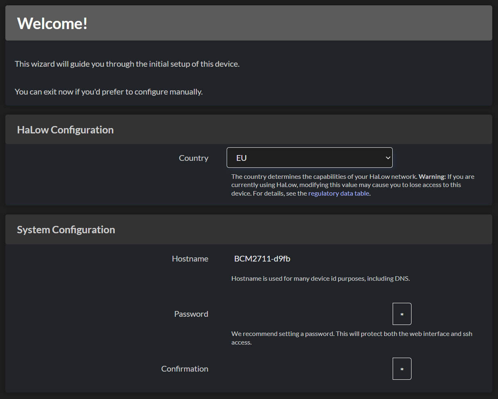

# OpenMANET using Heltec HT-HC01P V2 and Raspberry Pi 4B

How to get a **Heltec HT-HC01P V2** Wi-Fi HaLow HAT working on a **Raspberry Pi 4B** with **OpenMANET**.

OpenMANET's Pi 4 image is made for a different HaLow HAT (the Seeed WM6108), which uses different GPIO pins. On a Heltec HAT the radio looks like it starts, then keeps timing out. This guide swaps in the right pin settings and board configuration.

> **This guide only gets the Heltec hardware working:** the pin layout, the board config file and a channel setting the radio will accept. It doesn't set up a HaLow network. The setup wizard in the web UI does that; follow the [mesh](<WebUi Setup - Mesh.md>) or [star](<WebUi Setup - Star.md>) guide once you've finished here ([which one?](README.md#choosing-a-layout)).

Tested with OpenMANET 24.10 (1.8.1) and the EU (863–870 MHz) HT-HC01P V2.

---

## What you need

- Raspberry Pi 4B with the Heltec HT-HC01P V2 HAT fitted
- microSD card flashed with the OpenMANET **rpi4 mm6108 SPI** image, `openmanet-1.8.1-rpi4-mm6108-spi-squashfs-sysupgrade.img` (download from the [OpenMANET firmware page](https://openmanet.github.io/docs/firmware); its SHA-256 is in this folder's [README](README.md))
- A Windows, Mac or Linux PC with an Ethernet port (or a USB Ethernet adapter)
- Two files from this folder's [`Files`](Files) folder:
  - **`mm610x-spi-heltec.dtbo`**: the overlay that sets the Heltec pin layout
  - **`bcf_HC01P-V2.bin`**: Heltec's board config file for the V2 HAT. It's also on Heltec's resource page under **HT-HC01P_V2**. Don't use `bcf_HC01.bin`, which is for V1.

---

## Setup

### 1. Boot the Pi and open the web page

Boot the Pi from the OpenMANET card and plug an Ethernet cable from the Pi into your PC, either directly or through an Ethernet adapter.

Open **http://10.41.254.1** in a browser. Every new OpenMANET install uses this address.

> On the first login there's no password. Just click **Login**.

### 2. Fill in the welcome page

The welcome page asks for three things:



| Setting | What to enter |
|---|---|
| **Country** | `EU` |
| **Hostname** | A name unique to this Pi, e.g. `MeshGateWay` or `halow-node1`. It's used for DNS, so no two nodes should share one. Letters, numbers and hyphens only. |
| **Password** | Set one. It protects both the web interface and SSH. |

**Stop here.** Don't run the rest of the setup wizard yet. You'll come back to it after step 6.

### 3. Copy the two files to the Pi

On your **PC**, open a terminal (PowerShell on Windows) in the folder where you saved the `.bin` and `.dtbo` files, and run the commands below. Run them on the PC, not inside an SSH session. When asked, enter the password you set in step 2.

```sh
scp -O mm610x-spi-heltec.dtbo root@10.41.254.1:/boot/overlays/mm610x-heltec.dtbo
scp -O bcf_HC01P-V2.bin       root@10.41.254.1:/lib/firmware/morse/
```

> The `-O` matters: the Pi's SSH server doesn't support the newer copy method, and the copy fails without it.

### 4. Configure the Pi

SSH into the Pi:

```sh
ssh root@10.41.254.1
```

Then paste this whole block:

```sh
# Check the overlay copied correctly. The result must be 826dd0bcdaf29d8dbceabdab4b24f726
md5sum /boot/overlays/mm610x-heltec.dtbo

# Tell the Pi to boot with the Heltec pin layout (keeps a backup first)
cp /boot/distroconfig.txt /root/distroconfig.txt.bak
sed -i 's/^dtoverlay=mm610x-spi$/dtoverlay=mm610x-heltec/' /boot/distroconfig.txt

# Point the HaLow driver at the V2 board config when it loads at boot
sed -i 's/bcf=[^ ]*/bcf=bcf_HC01P-V2.bin/' /etc/modules.d/mm6108

# Point the HaLow radio (radio1) at the V2 board config, and use automatic channel selection
uci set wireless.radio1.bcf=bcf_HC01P-V2.bin
uci set wireless.radio1.channel='auto'
uci commit wireless
sync
```

If the `md5sum` result is different, copy the file again before going on. (The board config file's checksum, if you want to check it too, is `b409b153963e26ded40c7d46b2f1355d`.)

> The board config file name has to be the same in two places: `/etc/modules.d/mm6108`, used when the driver loads at boot, and `wireless.radio1.bcf`, used when the radio starts. The block above sets both. Why the channel is set to `auto` is explained [below](#why-the-channel-is-set-to-auto).

### 5. Power-cycle

```sh
poweroff
```

Unplug the Pi for about **10 seconds**, then plug it back in. A plain `reboot` leaves the HAT powered, so the HaLow chip can stay stuck in its old state. A full power-off resets it properly.

### 6. Check it works

SSH back in and run:

```sh
cat /sys/module/*/parameters/bcf
grep -i morse /proc/interrupts
dmesg | grep -iE "Loaded BCF|failsafe|health|CMD63"
iw dev
```

**It's working if:**

- The first command prints `bcf_HC01P-V2.bin`. (The driver is called `mm6108_sdio` even on this SPI image; that's expected.)
- The `Morse SPI IRQ` line shows pin **25** and a count above 0. Run it again and the count should go up.
- `dmesg` shows `Loaded BCF from morse/bcf_HC01P-V2.bin` and **no** `failsafe`, `health_check` or `CMD63` lines.
- `iw dev` lists an interface called **`wlh0`** with `txpower 16.00 dBm`.

If the first command prints a different file name, check `cat /etc/modules.d/mm6108` shows `bcf=bcf_HC01P-V2.bin`, run the `sed` line from step 4 again, then repeat step 5.

Done. Your HaLow radio is broadcasting.

> `iw dev` shows the HaLow channel as a 5 GHz number (e.g. "5660 MHz"). That's normal: the HaLow driver reports it that way. The real frequency (863–868 MHz) appears in `logread | grep hostapd_s1g`.

**Next:** go back to the web UI and set up the HaLow network. Choose a layout ([comparison](README.md#choosing-a-layout)), then follow [WebUi Setup - Mesh.md](<WebUi Setup - Mesh.md>) or [WebUi Setup - Star.md](<WebUi Setup - Star.md>).

---

## Why the channel is set to auto

With the country set to EU, a fixed channel made netifd (OpenWrt's network manager) ignore the HaLow interface completely: `wlh0` never came up and there was no obvious error. With `radio1.channel` set to `auto`, it came up straight away on S1G channel 2 (864 MHz, 2 MHz wide).

EU HaLow only has about 5 MHz of spectrum (863–868 MHz), so only a few S1G channel numbers are valid. With `auto`, the driver picks a channel that's valid for the country.

**Is auto OK for a mesh?** Mesh nodes all have to be on the same channel. With so few EU channels, auto will almost certainly pick the same one on every node, so it's fine for testing. For a dependable deployment, fix the channel once everything works:

1. On the working node, run `iw dev wlh0 info` to see the channel auto picked.
2. Set that exact channel on every node:
   ```sh
   uci set wireless.radio1.channel=<n>; uci commit wireless; wifi
   ```
3. Run `iw dev wlh0 info` again to check the interface still comes up. If `wlh0` disappears, set the channel back to `auto`.

---

## Troubleshooting

| What you see | Cause | Fix |
|---|---|---|
| `morse_cmd_health_check ... timed out` repeating, IRQ count stuck at 0 on pin 5 | The Pi is still using the Seeed pin layout | Repeat step 4. Check that `grep mm610x /boot/distroconfig.txt` says `mm610x-heltec` |
| `failed to init SPI with CMD63` | The chip wasn't reset properly | Do a full power-off (step 5), not a reboot |
| `failed with error -2` for a `bcf_...bin` file | The board config filename doesn't match the file | `ls /lib/firmware/morse/` and make both `uci get wireless.radio1.bcf` and the `bcf=` in `/etc/modules.d/mm6108` match it exactly (filenames are case-sensitive) |
| `firmware is in failsafe mode due to: Invalid BCF length` | The board config file is missing | As above |
| No `wlh0` in `iw dev`; `logread` shows `EU/GB must have channel set to auto` | A fixed channel is set | `uci set wireless.radio1.channel='auto' && uci commit wireless && wifi reload` |
| `wm6108-spi-reset: skipped` | OpenMANET's Seeed reset helper sees non-Seeed pins | Nothing to fix; this is expected |

**Things that catch people out**

- **radio1 is the HaLow radio.** radio0 is the Pi's built-in Wi-Fi. Settings for the HAT go on `radio1`.
- **The board config file name lives in two places.** `wireless.radio1.bcf` and `/etc/modules.d/mm6108` must both say `bcf_HC01P-V2.bin`.
- **Don't copy files via `/tmp`** if you plan to reboot first: `/tmp` is cleared on every boot.
- **`/boot` is already the SD card's boot partition.** Don't mount it a second time.
- **Re-flashing or upgrading OpenMANET undoes this setup.** Repeat steps 3 to 6 afterwards.

---

## Undoing the changes

On the Pi:

```sh
cp /root/distroconfig.txt.bak /boot/distroconfig.txt
reboot
```

If the Pi won't boot, put the SD card in a PC, open `distroconfig.txt` on the boot partition, and change `dtoverlay=mm610x-heltec` back to `dtoverlay=mm610x-spi`.

---

## Background: why the pins differ

| Signal | Seeed HAT (OpenMANET default) | Heltec HAT | Pi header pin (Heltec) |
|---|---|---|---|
| SPI CS0 / MISO / MOSI / CLK | GPIO 8 / 9 / 10 / 11 | same | 24 / 21 / 19 / 23 |
| IRQ | GPIO 5 | **GPIO 25** | 22 |
| RESET | GPIO 17 | **GPIO 5** | 29 |
| WAKE | GPIO 23 | **GPIO 3** | 5 |
| BUSY | GPIO 24 | **GPIO 7** | 26 |

SPI runs at 50 MHz in both. `mm610x-spi-heltec.dtbo` is the OpenMANET overlay with only these four pins changed.

## References

- [Morse Micro forum: Pi 4B with Heltec HT-HC01P](https://community.morsemicro.com/t/raspi-4b-with-heltec-ht-hc01p-with-debug-board/1081)
- [Beyond Logic: Seeed WM6108 pin mapping](https://www.beyondlogic.org/building-openwrt-for-the-seeed-studio-wm6108-802-11ah-halow-radio/)
- [Beyond Logic: Heltec HT-HC01P V1 vs V2](https://www.beyondlogic.org/heltec-automation-ht-hc01p-halow-mini-pcie-card/)
- [OpenMANET documentation](https://openmanet.github.io/docs)
