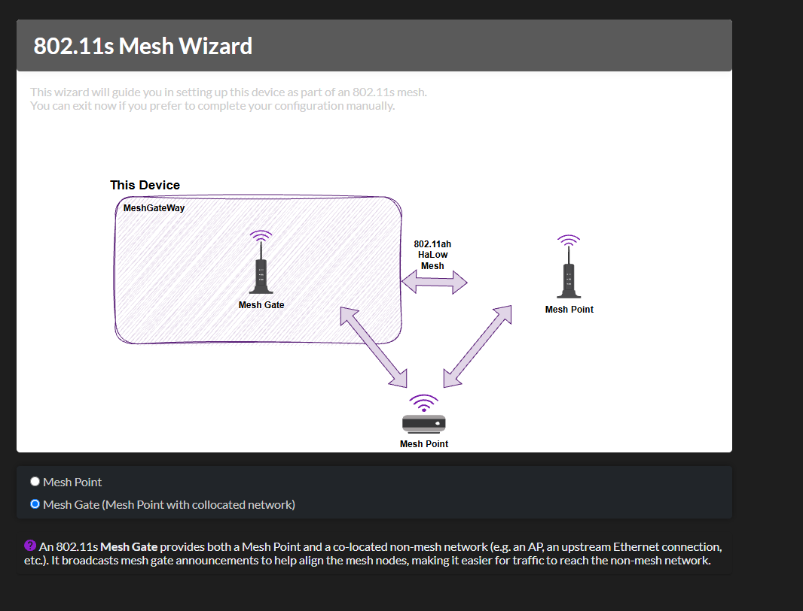
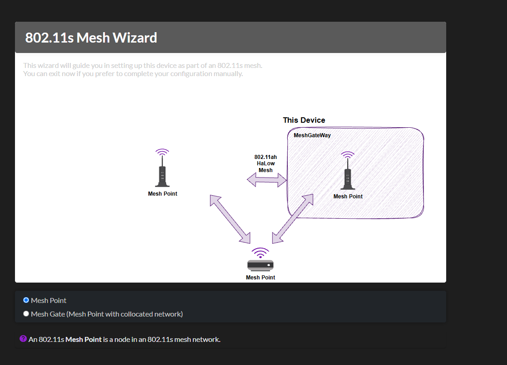
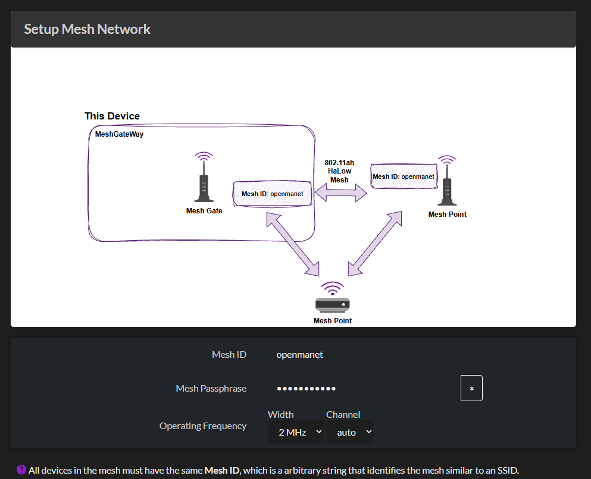
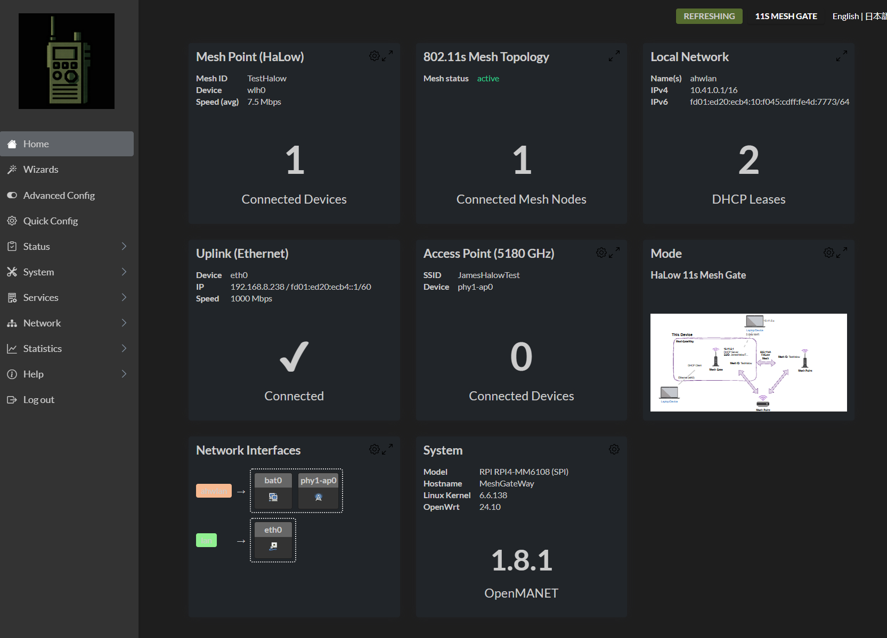

# OpenMANET Web UI Setup: Mesh

How to set up the HaLow network as a **mesh**, once the hardware is working ([RaspberryPi and HAT setup.md](<RaspberryPi and HAT setup.md>)).

One **base station** is connected to the internet by Ethernet. Each person carries their own Pi, and the Pis **relay for each other**: someone out of the base's range can still reach it through a node in between. Each phone connects to its own Pi over normal Wi-Fi.

```
 Internet ── Ethernet ── BASE (Mesh Gate)
                           ╎ HaLow
              ┌────────────┴────────────┐
           Pi (A) ─────── Pi (B) ─────── Pi (C)    ← relay for each other
             │              │              │
          Phone A        Phone B        Phone C
```

> **Mesh or star?** Mesh covers more ground but is slower in the EU/UK and needs a change to OpenMANET's driver script. If everyone stays in range of the base, the [star guide](<WebUi Setup - Star.md>) is simpler. The comparison is in the device [README](README.md#choosing-a-layout).

---

## 1. Run the wizard

Do this on every node: the base station first, then each carried node.

### Role

The first page of the wizard asks for **Mesh Point** or **Mesh Gate**.

| Base station: **Mesh Gate** | Carried nodes: **Mesh Point** |
|---|---|
|  |  |

- **Mesh Gate (base station):** a mesh node with a **non-mesh network on the same device**, such as the upstream Ethernet connection, which it joins to the mesh. It announces itself, so every node already knows its route out to the internet.
- **Mesh Point (carried nodes):** a plain member of the mesh. It joins using the Mesh ID and passphrase and **relays traffic** for other nodes. The wizard still lets you turn on the Pi's Wi-Fi hotspot for the phone, so turn it on.

### Setup Mesh Network

These settings must be **identical on every node**, or they won't join each other.



| Setting | What to enter |
|---|---|
| **Mesh ID** | A name for your mesh, like a Wi-Fi name. Change it from the default `openmanet`, otherwise you could join someone else's OpenMANET mesh nearby. |
| **Mesh Passphrase** | A strong passphrase of your own, at least 8 characters. Anyone who has it can join the mesh and see its traffic. |
| **Width** | `2 MHz`. Narrower reaches further; wider is faster but shorter range. |
| **Channel** | Leave on `auto` here. Step 2 sets a fixed channel. |

### Settings for each node

| Setting | Base station | Carried nodes |
|---|---|---|
| **Role** | Mesh Gate | Mesh Point |
| **Hostname** | Unique, e.g. `MeshGateWay` | Unique, e.g. `halow-alice` |
| **Upstream** | **Ethernet** | None |
| **Pi Wi-Fi (radio0)** | Optional hotspot | **Hotspot** for that person's phone |
| **Country** | EU | EU |
| **Mesh ID / passphrase** | Your own | Same as the base |
| **HaLow channel** | `2`, fixed (step 2) | Same as the base |

- **Use Ethernet for the base station's internet,** directly or through a travel router. On a Pi 4, the built-in Wi-Fi can't connect upstream and run a hotspot at the same time.
- **The hotspot name (SSID)** can be different per person (e.g. `Mesh-Alice`) or the same everywhere. Either way, all phones end up on one network and get addresses from the base.

---

## 2. Fix the EU/UK mesh block

> **In the EU and UK, the mesh won't start until you do this.** The wizard finishes normally, but the nodes never connect.

OpenMANET's HaLow driver script (`/lib/netifd/wireless/morse.sh`) refuses to start a mesh interface when the country is `EU` or `GB`. The log shows:

```
wifi-iface 0 mode=mesh ignored; EU/GB cannot use mesh/adhoc interfaces due to regulatory restrictions
```

Morse Micro, who make the HaLow chip, disable mesh in their EU/GB software because performance under the EU duty-cycle limit is poor ([Morse Micro forum](https://community.morsemicro.com/t/802-11s-mesh-for-eu-bands/1355)). The limit itself is enforced by the driver and firmware, not by this script, so removing the block keeps the radio within the EU limits.

**Symptoms:** `iw dev` shows no HaLow interface, `batctl n` is empty, and `logread` fills with `openmanetd` errors about `batctl` failing.

On **every node**, SSH in and paste:

```sh
# 1. Back up the driver script
[ -f /root/morse.sh.orig ] || cp /lib/netifd/wireless/morse.sh /root/morse.sh.orig

# 2. Comment out the EU/GB mesh block (the first "return 9" is mesh; the second is ad-hoc and stays)
L=$(grep -n 'auto_channel_only" = 1 \] && return 9' /lib/netifd/wireless/morse.sh | head -1 | cut -d: -f1)
sed -i "${L}s/^/#/" /lib/netifd/wireless/morse.sh
grep -n 'return 9' /lib/netifd/wireless/morse.sh   # first line starts with #, second doesn't

# 3. Mesh needs a fixed channel (it refuses "auto" in every country). Same on every node.
uci set wireless.radio1.channel='2'
uci set wireless.radio1.s1g_chanbw='2'
uci commit wireless
wifi
```

Run step 2 only once per node. Running it again adds a second `#`, which is harmless.

Channel 2 at 2 MHz is 864 MHz. It's the channel `auto` picked during testing, so this build accepts it in the EU.

---

## 3. Check it works

Wait about 30 seconds after the last node, then on any node:

```sh
iw dev                 # wlh0 ... type mesh point
batctl n               # lists the other node(s)
iw dev wlh0 station dump | grep -E "Station|signal:|mesh plink"   # mesh plink: ESTAB
cat /sys/module/mm6108_sdio/parameters/enable_auto_duty_cycle      # Y = duty-cycle limit on
ping <other node's IP>
```

The `logread` should show `joining mesh <your Mesh ID>` and `MESH-GROUP-STARTED`, with no `ignored` line. `batctl n` can take up to a minute to list a neighbour.

On the dashboard, the **802.11s Mesh Topology** card says **active** with the number of connected mesh nodes:



Then connect a phone to a carried node's hotspot. Turn on Low Data Mode first; see [Controlling traffic over HaLow](#controlling-traffic-over-halow).

### What to expect

Tested with two nodes a few metres apart:

| Measurement | Result |
|---|---|
| Link speed (`batctl n` / dashboard) | About 7.2–7.5 Mbit/s, the top rate of a 2 MHz channel |
| Ping between nodes, nothing on the hotspot | Usually 250 ms–1 s, occasionally 10–30 ms. The first few pings after start-up take up to 4 s while the route forms. |
| Ping to an iPhone on a carried node's hotspot | 11–24 s with 60–80% loss. The phone's own background traffic used up the airtime. |

The radio link is fast; the delay comes from packets waiting for airtime under the duty-cycle limit.

---

## Troubleshooting

| What you see | Cause | Fix |
|---|---|---|
| No `wlh0` in `iw dev`; `logread` says `EU/GB cannot use mesh/adhoc interfaces` | The driver script is unchanged, or was restored by an update | Repeat [step 2](#2-fix-the-euuk-mesh-block) |
| `logread` says `cannot have channel=auto in this mode` | The channel is still `auto` (for example after re-running the wizard) | `uci set wireless.radio1.channel='2'; uci commit wireless; wifi` |
| `logread` says `requires valid country/channel setup` | The channel number isn't valid for EU in this build | Check `uci get wireless.radio1.channel` and `s1g_chanbw`; use `2` and `2` |
| `wlh0` is up but `batctl n` stays empty | The nodes' Mesh ID, passphrase or channel differ | Compare `uci show wireless \| grep -E "mesh_id\|channel\|chanbw"` on both nodes, and check the passphrase in the web UI |
| Pings take many seconds, with heavy loss | Devices on the hotspot are using up the HaLow airtime | See [Controlling traffic over HaLow](#controlling-traffic-over-halow) |

---

## Undo

On each node:

```sh
cp /root/morse.sh.orig /lib/netifd/wireless/morse.sh
uci set wireless.radio1.channel='auto'
uci commit wireless
wifi
```

> **Re-running the wizard may set the channel back to `auto`**, and **a sysupgrade or reflash restores the original script.** Check both afterwards.

---

## TAK

- Put the **TAK Server on the base network**, on a machine at the base or the base Pi itself, not out on the internet. If the internet drops, TAK still works across the mesh.
- Point ATAK / iTAK at the TAK Server's **local IP**.
- Without a server, ATAK's built-in mesh mode (multicast position sharing) can work, but every broadcast goes over HaLow to every node. With more people, a server uses less airtime.

---

## Controlling traffic over HaLow

In the EU/UK this matters more than anything else in this guide.

### The problem

Each mesh node gets about **2.8% airtime** under the EU duty-cycle limit. On a 2 MHz channel that's roughly 7.2 Mbit/s × 2.8% ≈ **200 kbit/s at best**, before the mesh's own overhead. Phones and laptops on the hotspot treat it as normal internet and send far more than that in the background: iCloud and photo backup, app and OS updates, messaging sync, browser tabs.

Packets that don't fit wait in a queue, and the queue keeps growing. That's why pings rise steadily to 10–20 s and then start dropping, and why everyone sharing the mesh suffers.

### Check whether this is happening

**1. Best case, with nothing connected.** Disconnect every phone and laptop from the carried node's hotspot. Use the base's hotspot or Ethernet for SSH. Wait 30 seconds, then on the base:

```sh
ping -c 30 <carried node IP>
```

Under about 1 s means the link itself is fine.

**2. How much the devices send.** Reconnect a device, then on the carried node:

```sh
a=$(cat /sys/class/net/wlh0/statistics/tx_bytes); sleep 10; b=$(cat /sys/class/net/wlh0/statistics/tx_bytes); echo "$(( (b-a)*8/10/1000 )) kbit/s"
```

Anything over about 100 kbit/s is more than the link can carry, and the delays will build.

### What to do

**On every phone and laptop (now):**
- **iPhone / iPad:** turn on **Low Data Mode** for the hotspot (Settings → Wi-Fi → ⓘ). Turn off **iCloud Photos** and **Background App Refresh**.
- **Android:** set the hotspot network to **Metered** (Wi-Fi → network → ⚙ → Metered). Turn off auto-backup and auto-update.
- **Mac / Windows:** set the network to Low Data Mode or Metered connection, pause cloud sync (iCloud Drive, OneDrive, Dropbox), and turn off automatic updates.

**On each carried node (for deployment):** firewall rules that **only let TAK traffic** (and anything else you choose, such as messaging) **cross HaLow**, and block the rest at the hotspot. Blocked traffic never uses HaLow airtime, so TAK gets all of it. *To be added once the TAK setup is decided (TAK Server ports or ATAK mesh mode).*

---

## Phones and power

| Topic | What to expect |
|---|---|
| **Speed** | About 200 kbit/s at best per node, shared by everything on its hotspot and by traffic it relays for others. Fine for TAK positions, chat and markers. Not enough for browsing, video or streaming. |
| **Phones dropping Wi-Fi** | Android and iOS may leave a Wi-Fi network they think has "no internet". Turn off **Switch to mobile data** / **Wi-Fi Assist**, and tap **Stay connected** when asked. |
| **Range** | Around 1 km per hop with clear line of sight and antennas up high. Carried at chest or hip height, with bodies, trees and buildings in the way, expect much less. People in between relay for people further out. Test on the ground before relying on it. |
| **Power** | A Pi 4 with the HAT draws about 3–6 W. A 10,000 mAh USB-C power bank gives roughly 6–10 hours; test it with your own setup. |
| **EU rules** | Keep the country set to EU so the radio stays within the duty-cycle limits. Don't set `duty_cycle_mode` or `enable_auto_duty_cycle` yourself. |

---

## Test order

1. Base station plus **one** carried node: steps 1–3. Check `batctl n` shows the other node.
2. With nothing on the hotspot, ping the carried node from the base to get the best-case delay. Then add a phone in Low Data Mode, check it can reach the base (`10.41.0.1`), and [measure what it sends](#check-whether-this-is-happening).
3. TAK Server at the base. Connect ATAK from the phone and check positions update.
4. Walk test: carry the node away from the base and note where the link drops.
5. Add a second carried node between the two and check traffic hops through it (`batctl o` shows the route).
