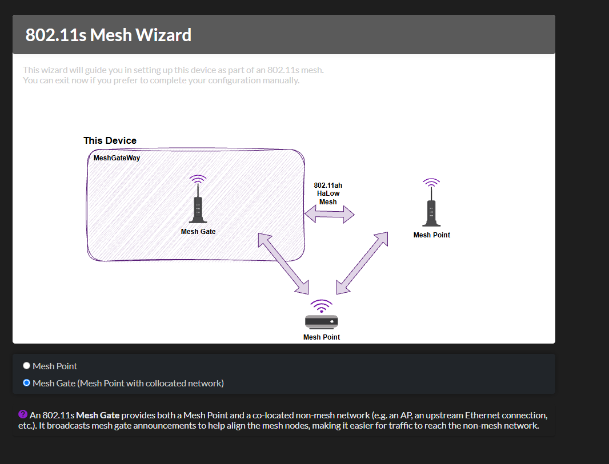
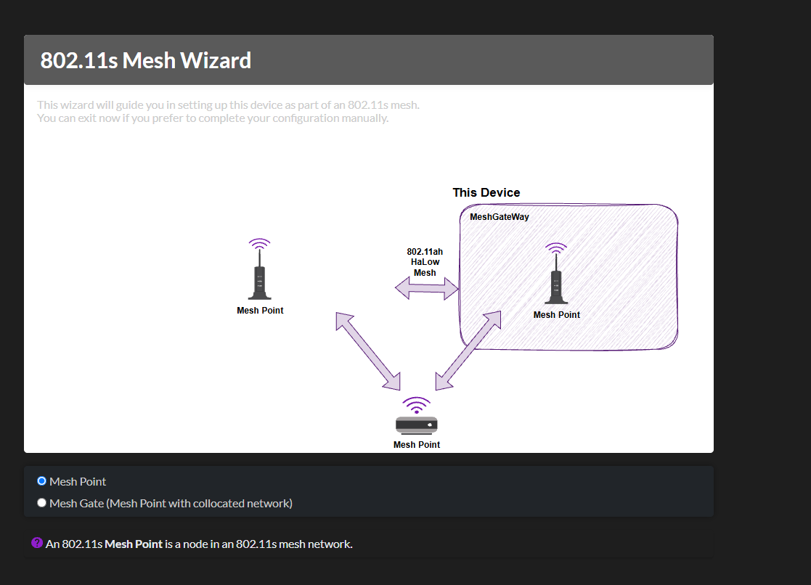
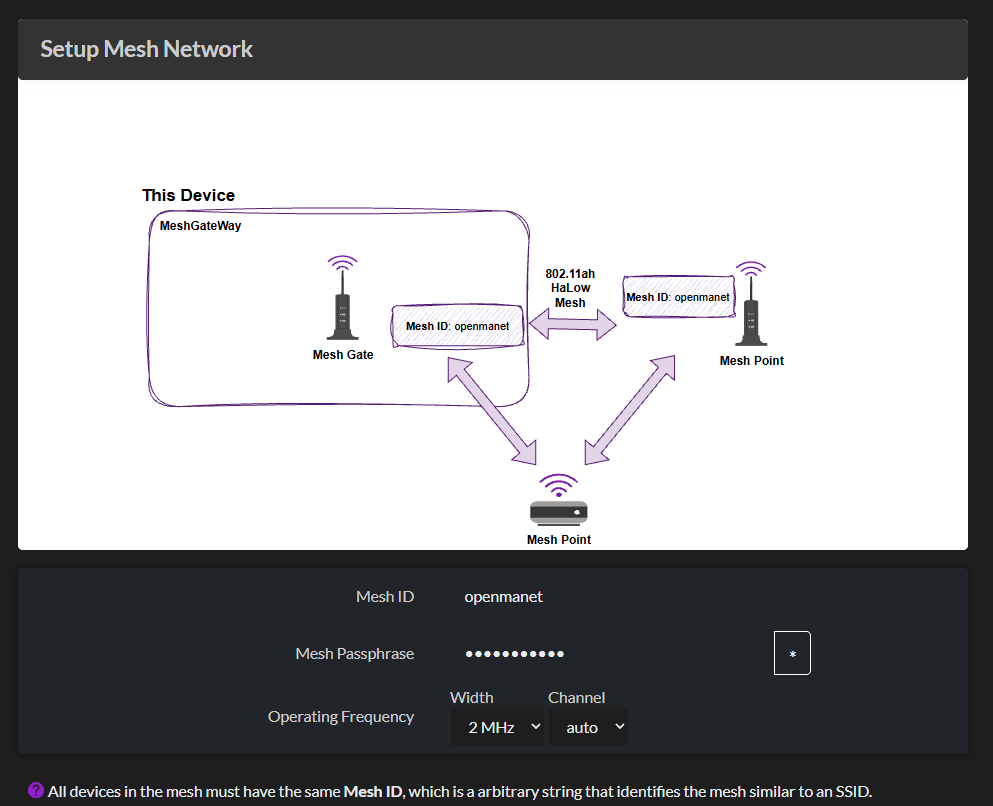
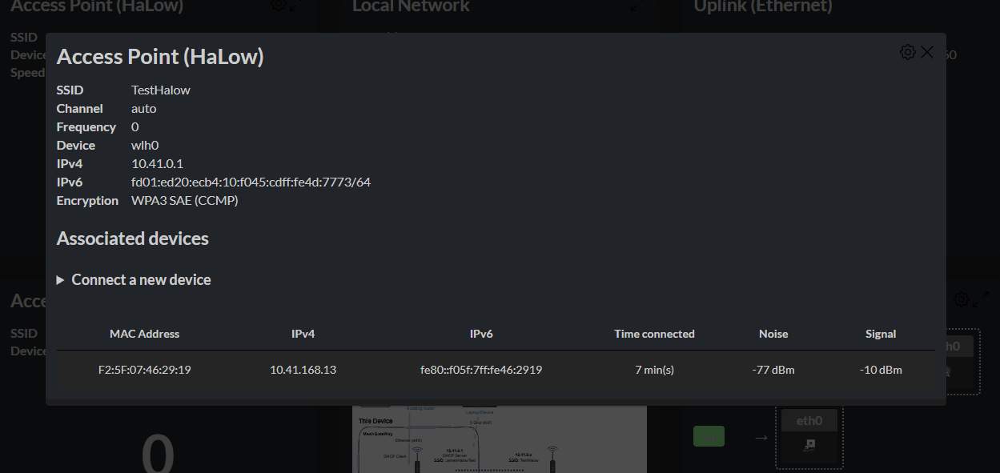

# OpenMANET Web UI Setup: Star

How to set up the HaLow network as a **star**, once the hardware is working ([RaspberryPi and HAT setup.md](<RaspberryPi and HAT setup.md>)).

One **base station** is connected to the internet by Ethernet and runs a HaLow **access point**. Each person carries their own Pi, which connects **directly to the base** as a HaLow client, like a phone to a Wi-Fi router. Each phone connects to its own Pi over normal Wi-Fi and gets its address from the base.

```
 Internet ── Ethernet ── BASE (HaLow access point)
                           ╎ HaLow
              ┌────────────┼────────────┐
           Pi (A)        Pi (B)        Pi (C)      ← each must reach the base
             │              │              │
          Phone A        Phone B        Phone C
```

Traffic between A and C goes through the base. There's no relaying: **every carried node must be in range of the base**, so mount the base's antenna as high as possible (mast, roof or vehicle).

> **Star or mesh?** Star works in the EU/UK as shipped and has less overhead, but can't reach people beyond the base's range. If you need nodes to relay for each other, use the [mesh guide](<WebUi Setup - Mesh.md>). The comparison is in the device [README](README.md#choosing-a-layout).

---

## 1. Run the wizard

Do this on every node: the base station first, then each carried node.

OpenMANET's wizard only sets up a mesh, so you run it as if you were building one. Steps 2 and 3 then switch each node to star mode. The wizard still does the useful work: hostname, password, Ethernet uplink, phone hotspot, and the network name and passphrase.

### Role

The first page of the wizard asks for **Mesh Point** or **Mesh Gate**.

| Base station: **Mesh Gate** | Carried nodes: **Mesh Point** |
|---|---|
|  |  |

- **Base station: Mesh Gate.** This sets it up with the Ethernet uplink and as the network's DHCP server. Step 2 turns it into the HaLow access point.
- **Carried nodes: Mesh Point.** Turn on the Pi's Wi-Fi hotspot for the phone. Step 3 turns it into a HaLow client of the base.

### Setup Mesh Network

These settings must be **identical on every node**. In star mode the Mesh ID becomes the base's HaLow network name, and the passphrase becomes its password.



| Setting | What to enter |
|---|---|
| **Mesh ID** | A name for your HaLow network. Change it from the default `openmanet`, otherwise you could clash with someone else's OpenMANET network nearby. |
| **Mesh Passphrase** | A strong passphrase of your own, at least 8 characters. Anyone who has it can join and see the traffic. |
| **Width** | `2 MHz`. Narrower reaches further; wider is faster but shorter range. |
| **Channel** | `auto`. In the EU/UK the access point must use `auto`, and the clients follow it. |

### Settings for each node

| Setting | Base station | Carried nodes |
|---|---|---|
| **Wizard role** | Mesh Gate | Mesh Point |
| **Star role** (steps 2–3) | HaLow access point | HaLow client |
| **Hostname** | Unique, e.g. `MeshGateWay` | Unique, e.g. `halow-alice` |
| **Upstream** | **Ethernet** | None |
| **Pi Wi-Fi (radio0)** | Optional hotspot | **Hotspot** for that person's phone |
| **Country** | EU | EU |
| **Mesh ID / passphrase** | Your own | Same as the base |
| **HaLow channel** | `auto` | `auto` |
| **Hands out addresses (DHCP)** | Yes | No (step 3 turns it off) |

- **Use Ethernet for the base station's internet,** directly or through a travel router. On a Pi 4, the built-in Wi-Fi can't connect upstream and run a hotspot at the same time.
- **The hotspot name (SSID)** can be different per person (e.g. `Mesh-Alice`) or the same everywhere.

---

## Before steps 2 and 3

- **Switching from the mesh guide?** First run its [Undo](<WebUi Setup - Mesh.md#undo>) on every node, so the driver script and channel are back to normal.
- **Don't lock yourself out of a carried node.** After step 3, devices on its hotspot get their address from the base over HaLow. If the link doesn't come up, nothing new gets an address. Keep your SSH session open. If you do get locked out, give your laptop a fixed address such as `10.41.168.50/16` and SSH to the node's own IP.

Each carried node bridges its phone hotspot onto the base's network using 4-address (WDS) mode. No changes to the driver script are needed, and the commands keep the Mesh ID and passphrase from the wizard, so there's nothing to retype.

---

## 2. Base station: HaLow access point

SSH in and paste:

```sh
# Back up the wizard's config so you can undo
cp /etc/config/wireless /root/wireless.wizard

# The access point needs channel auto in EU/GB, and smart_manager running
uci set wireless.radio1.channel='auto'
service smart_manager status

# Switch the HaLow interface from mesh to access point
B=$(ip -br link show type bridge | awk '/ahwlan/ {print $1}')
echo "LAN bridge: $B"            # expect br-ahwlan
uci set wireless.default_radio1.mode='ap'
uci set wireless.default_radio1.ssid="$(uci get wireless.default_radio1.mesh_id)"
uci set wireless.default_radio1.wds='1'
uci set wireless.default_radio1.wds_bridge="$B"
uci set wireless.default_radio1.network='ahwlan'
uci -q delete wireless.default_radio1.mesh_id
uci commit wireless
wifi
```

If `service smart_manager status` doesn't say `running`, start it with `service smart_manager enable; service smart_manager start` and run `wifi` again. In the EU the access point won't start without it.

**Check before going on:**

```sh
sleep 15
iw dev | grep -A6 wlh0          # type AP, ssid <your Mesh ID>
logread | grep -v openmanetd | grep -iE "radio1|ignored|hostapd" | tail -10   # AP-ENABLED, no "ignored"
```

---

## 3. Each carried node: HaLow client

Only start once the base shows `wlh0` as `type AP`. SSH in and paste:

```sh
# Back up the wizard's config so you can undo
cp /etc/config/wireless /root/wireless.wizard
cp /etc/config/dhcp /root/dhcp.wizard

# Switch the HaLow interface from mesh to client of the base
uci set wireless.radio1.channel='auto'
uci set wireless.default_radio1.mode='sta'
uci set wireless.default_radio1.ssid="$(uci get wireless.default_radio1.mesh_id)"
uci set wireless.default_radio1.wds='1'
uci set wireless.default_radio1.network='ahwlan'
uci -q delete wireless.default_radio1.mesh_id
uci commit wireless

# Check the DHCP section name: the list should include dhcp.ahwlan=dhcp
uci show dhcp | grep -E "^dhcp\.[^.]+=dhcp"
```

If the list includes `dhcp.ahwlan=dhcp`, finish with the commands below. This lets the base hand out all addresses, because two DHCP servers on one network clash. It also applies the new settings, since nothing changes until `wifi` runs.

```sh
uci set dhcp.ahwlan.ignore='1'
uci commit dhcp
wifi
service dnsmasq restart
```

---

## 4. Check it works

**On a carried node:**

```sh
sleep 20
iw dev wlh0 link        # "Connected to <base HaLow MAC>", SSID <your Mesh ID>
iw dev wlh0 info | grep -iE "type|4addr"   # type managed, 4addr: on
```

**On the base:**

```sh
iw dev | grep -E "Interface|type"   # wlh0 type AP, plus one wlh0.staN per carried node
bridge link | grep wlh0             # the wlh0.staN links are in the LAN bridge
ping -c 20 <carried node IP>
cat /tmp/dhcp.leases                # phones on carried nodes appear here
```

On the base's dashboard, the **Access Point (HaLow)** card lists each carried node under **Associated devices**, with its own IP:



Then connect a phone to a carried node's hotspot. Turn on Low Data Mode first; see [Controlling traffic over HaLow](#controlling-traffic-over-halow). It should get a `10.41.0.x` address **from the base** (check `cat /tmp/dhcp.leases` on the base), and `ping <phone IP>` from the base should answer.

`openmanetd` will keep logging `batctl` errors, because the mesh isn't used. They're harmless, and the dashboard's mesh cards will show 0.

### What to expect

Tested with two nodes a few metres apart:

| Measurement | Result |
|---|---|
| Carried node connects to the base | ✅ Shown under Associated devices, WPA3 SAE |
| Devices on the carried node's hotspot | ✅ Get `10.41.0.x` addresses from the base and are reachable from it |
| Ping to the carried node, nothing on the hotspot | Not yet measured |
| Ping to the carried node, phone on the hotspot | 9–16 s with 68% loss |
| Ping to a Mac on the carried node's hotspot | 6–11 s with 55% loss |

The slow results were with devices on the hotspot using up the airtime; see [Controlling traffic over HaLow](#controlling-traffic-over-halow).

---

## Troubleshooting

| What you see | Cause | Fix |
|---|---|---|
| Base: no `type AP`, or `logread` mentions `smart_manager` / DCS | smart_manager isn't running | `service smart_manager enable; service smart_manager start; wifi` |
| Base: `logread` says `EU/GB must have channel set to auto` | A fixed channel is set | `uci set wireless.radio1.channel='auto'; uci commit wireless; wifi` |
| Carried node: `iw dev wlh0 link` says `Not connected` right after the commands | `wifi` hasn't run yet; the old mesh settings are still active | Run the last block of step 3 (`wifi` and `service dnsmasq restart`) |
| Carried node stays `Not connected` | Network name or passphrase differs from the base, or the base's access point isn't up | Compare `uci get wireless.default_radio1.ssid` on both, and check the base shows `type AP` |
| Base can ping the carried node's own IP, but not a phone on its hotspot | The phone still has an address from the carried node's old DHCP server | On the phone, tap **Forget This Network** and rejoin. It should then appear in `/tmp/dhcp.leases` on the base. |
| Phone can't get an address at all | The 4-address bridge isn't working | On the base, `iw dev` should show `wlh0.sta1` and `bridge link \| grep wlh0` should list it. On the carried node, `iw dev wlh0 info` should say `4addr: on`. |
| Pings take many seconds, with heavy loss | Devices on the hotspot are using up the HaLow airtime | See [Controlling traffic over HaLow](#controlling-traffic-over-halow) |
| Locked out of a carried node | Its DHCP is off and the HaLow link is down | Give your laptop a fixed `10.41.168.50/16`, connect to the node's hotspot or Ethernet, and SSH to its own IP |

---

## Undo

On each node, to go back to the wizard's mesh settings:

```sh
cp /root/wireless.wizard /etc/config/wireless
[ -f /root/dhcp.wizard ] && cp /root/dhcp.wizard /etc/config/dhcp
wifi
service dnsmasq restart
```

> **Re-running the wizard switches the node back to mesh settings.** Repeat steps 2–3 afterwards.

---

## TAK

- Put the **TAK Server on the base network**, on a machine at the base or the base Pi itself, not out on the internet. If the internet drops, TAK still works.
- Point ATAK / iTAK at the TAK Server's **local IP**.
- Without a server, ATAK's built-in mesh mode (multicast position sharing) can work, but every broadcast goes through the base to every node. With more people, a server uses less airtime.

---

## Controlling traffic over HaLow

In the EU/UK this matters more than anything else in this guide.

### The problem

Each carried node is a HaLow client and gets about **2.8% airtime** under the EU duty-cycle limit. On a 2 MHz channel that's roughly 7.2 Mbit/s × 2.8% ≈ **200 kbit/s at best**. Phones and laptops on the hotspot treat it as normal internet and send far more than that in the background: iCloud and photo backup, app and OS updates, messaging sync, browser tabs.

Packets that don't fit wait in a queue, and the queue keeps growing. That's why pings rise steadily to 10–20 s and then start dropping.

### Check whether this is happening

**1. Best case, with nothing connected.** Disconnect every phone and laptop from the carried node's hotspot. Use the base's hotspot or Ethernet for SSH. Wait 30 seconds, then on the base:

```sh
ping -c 30 <carried node IP>
```

Under about 1 s means the link itself is fine.

**2. How much the devices send.** Reconnect a device, then on the carried node:

```sh
a=$(cat /sys/class/net/wlh0/statistics/tx_bytes); sleep 10; b=$(cat /sys/class/net/wlh0/statistics/tx_bytes); echo "$(( (b-a)*8/10/1000 )) kbit/s"
```

Anything over about 100 kbit/s is more than the link can carry, and the delays will build.

### What to do

**On every phone and laptop (now):**
- **iPhone / iPad:** turn on **Low Data Mode** for the hotspot (Settings → Wi-Fi → ⓘ). Turn off **iCloud Photos** and **Background App Refresh**.
- **Android:** set the hotspot network to **Metered** (Wi-Fi → network → ⚙ → Metered). Turn off auto-backup and auto-update.
- **Mac / Windows:** set the network to Low Data Mode or Metered connection, pause cloud sync (iCloud Drive, OneDrive, Dropbox), and turn off automatic updates.

**On each carried node (for deployment):** firewall rules that **only let TAK traffic** (and anything else you choose, such as messaging) **cross HaLow**, and block the rest at the hotspot. Blocked traffic never uses HaLow airtime, so TAK gets all of it. *To be added once the TAK setup is decided (TAK Server ports or ATAK mesh mode).*

---

## Phones and power

| Topic | What to expect |
|---|---|
| **Speed** | About 200 kbit/s at best per carried node, shared by everything on its hotspot. Fine for TAK positions, chat and markers. Not enough for browsing, video or streaming. |
| **Phones dropping Wi-Fi** | Android and iOS may leave a Wi-Fi network they think has "no internet". Turn off **Switch to mobile data** / **Wi-Fi Assist**, and tap **Stay connected** when asked. |
| **Range** | Around 1 km from the base with clear line of sight and the base antenna up high. Carried at chest or hip height, with bodies, trees and buildings in the way, expect much less. Test on the ground before relying on it. |
| **Power** | A Pi 4 with the HAT draws about 3–6 W. A 10,000 mAh USB-C power bank gives roughly 6–10 hours; test it with your own setup. |
| **EU rules** | Keep the country set to EU so the radio stays within the duty-cycle limits. Don't set `duty_cycle_mode` or `enable_auto_duty_cycle` yourself. |

---

## Test order

1. Base station plus **one** carried node: steps 1–4. Check the base lists the carried node under Associated devices.
2. With nothing on the hotspot, ping the carried node from the base to get the best-case delay. Then add a phone in Low Data Mode, check it gets an address from the base, and [measure what it sends](#check-whether-this-is-happening).
3. TAK Server at the base. Connect ATAK from the phone and check positions update.
4. Walk test: carry the node away from the base and note where the link drops. With no relaying, that's the edge of your coverage.
